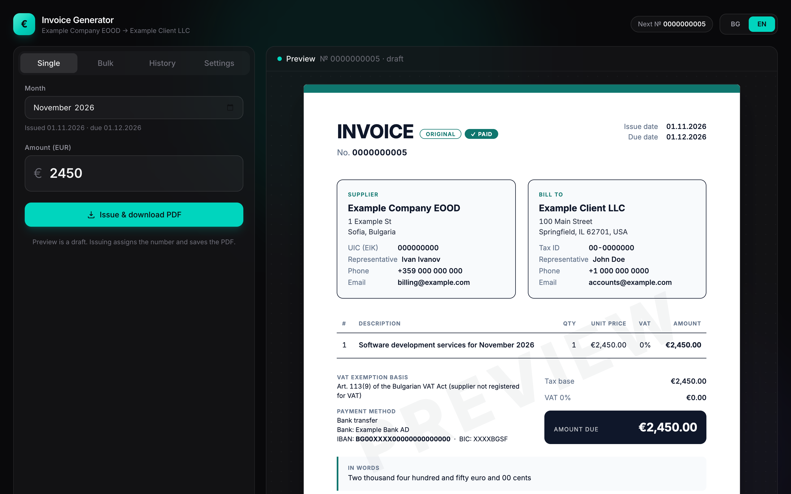
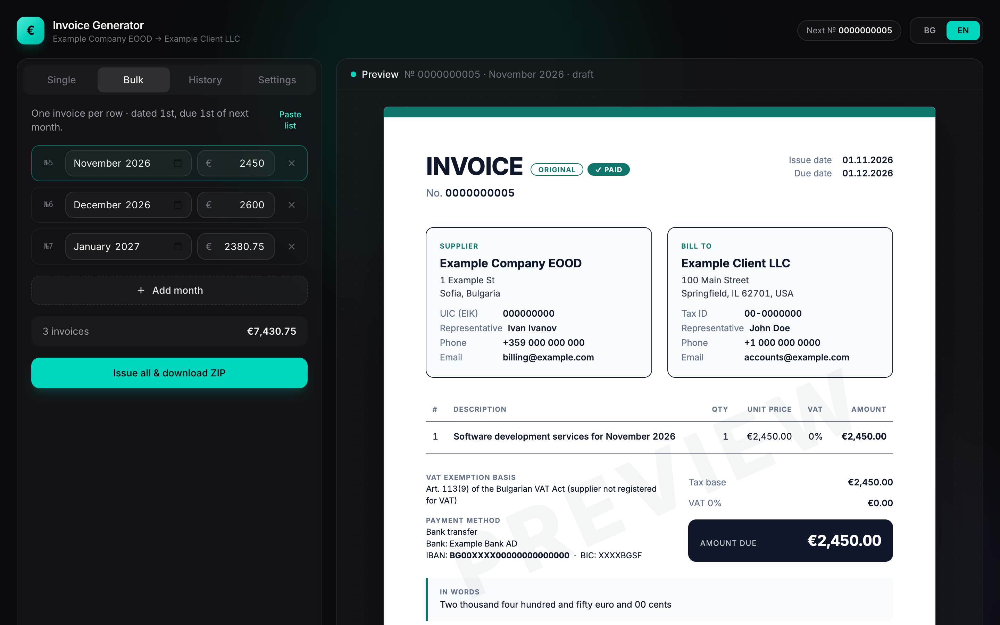
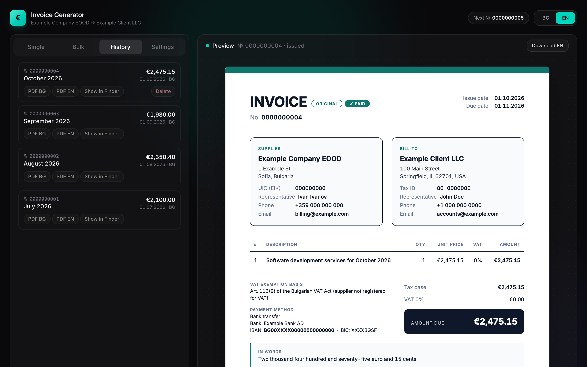
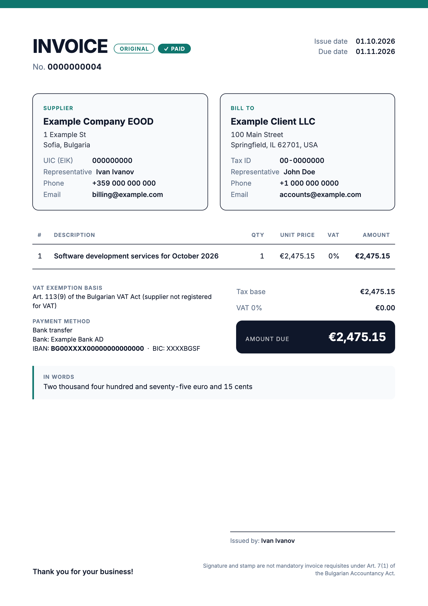
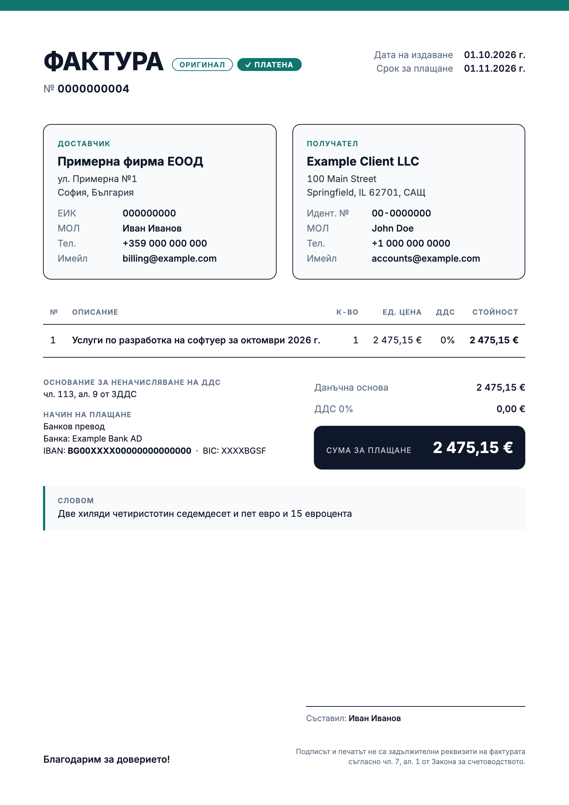
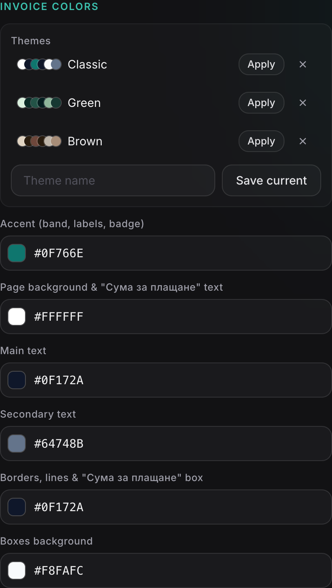

# Invoice Generator

[Българска версия](README.md)

A local invoice generator for Bulgarian companies that bill the same client every month. Runs entirely on your machine, amounts are always in euro (€), invoices are issued in Bulgarian (default) or English and exported to PDF.

## Screenshots



| Bulk issuing | History |
|---|---|
|  |  |

| Invoice (EN) | Invoice (BG) | Colour themes |
|---|---|---|
|  |  |  |

Screenshots use dummy data. Regenerate them with `npm run screenshots` — the script uses a temporary dataset and never touches yours.

## Features

- **Live preview** while you type the month and amount.
- **Bulk issuing** — one row per month (month + amount), or paste a list; downloaded as a ZIP.
- **History** — re-download any issued invoice in Bulgarian or English.
- **Settings** — supplier and client details, bank/IBAN, VAT exemption basis, starting number, output folder.
- **Colour themes** — 6 HEX colours with swatches; save and apply your own themes. Presets "Classic", "Green" and "Brown" are included.
- **CLI** — everything the web UI does is available from the command line.
- Dark, smooth UI built with Tailwind CSS. No database, no external services.

## Online version

**[https://omegaskiller.github.io/invoice-generator/](https://omegaskiller.github.io/invoice-generator/)** — runs in your browser, no install, no sign-up.

- Your data (settings, themes, issued invoices) stays in your browser (localStorage). Nothing is sent to a server.
- PDFs are created through the browser's print dialog: choose "Save as PDF". Bulk issuing prints all invoices as one PDF, one page per invoice.
- Clearing site data deletes your invoice history. Export a backup regularly from **Settings → Backup**.

The local version (below) writes real PDF files to a folder, builds ZIP archives and has a CLI.

## Requirements

- Node.js 20+
- Google Chrome, Chromium, Edge or Brave (used to render PDFs). Set `CHROME_PATH` if it is installed somewhere non-standard.

## Run

```bash
npm install
npm start
```

Open http://localhost:4321 and fill in your details under **Settings**. They are stored in `data/settings.json`, which is git-ignored.

## Dates & numbering

- **Issue date:** 1st of the month.
- **Due date:** 1st of the next month.
- **Number:** 10-digit sequential (`0000000001`, …), continuing from the last issued invoice or the starting number in Settings.
- Every invoice carries a "Paid" badge.

## CLI

```bash
node cli.js new -m 2026-11 -a 1250.50                 # one invoice (asks to confirm)
node cli.js new -m 2026-11 -a 1250.50 -l en --yes      # English, no prompt
node cli.js bulk 2026-01=1000 2026-02=1100 --preview   # draft HTML only
node cli.js bulk -f templates/example.txt --yes        # bulk from a template file
node cli.js list                                       # issued invoices
node cli.js pdf 5 -l en                                # re-export an issued invoice
node cli.js next                                       # next number
```

`npm link` makes it available globally as `invoice`.

Bulk templates are text files with one `YYYY-MM amount` per line; lines starting with `#` are comments. See [templates/example.txt](templates/example.txt).

## Files

| Path | Contents |
|---|---|
| `data/settings.json` | Your settings (created on first run) |
| `data/invoices.json` | Issued invoices. Each stores a snapshot, so old invoices never change. |
| `data/logo.png` / `.svg` | Optional logo |
| `output/` | Generated PDFs (configurable) |
| `templates/` | Bulk templates |

All personal data lives in `data/`, `output/` and `templates/`, which are excluded from Git.

## Bulgarian legal requirements

Invoices include the requisites of Art. 114 of the Bulgarian VAT Act: "Фактура" + "Оригинал", 10-digit sequential number, issue date, supplier and recipient name/address/ID, representative (МОЛ), description, quantity, unit price, tax base, VAT rate and amount, total, and amount in words.

The default VAT exemption basis is Art. 113(9) of the VAT Act (supplier not VAT-registered). If you are registered, add your VAT number and change the basis in Settings.

Signature and stamp are not mandatory under Art. 7(1) of the Accountancy Act.

> This tool is not legal advice. Check your invoices with your accountant.

## Development

```bash
npm run build:static   # builds the browser version into dist/
npm run screenshots    # regenerates screenshots with dummy data
```

Every push to `main` deploys `dist/` to GitHub Pages via GitHub Actions.

## License

MIT
