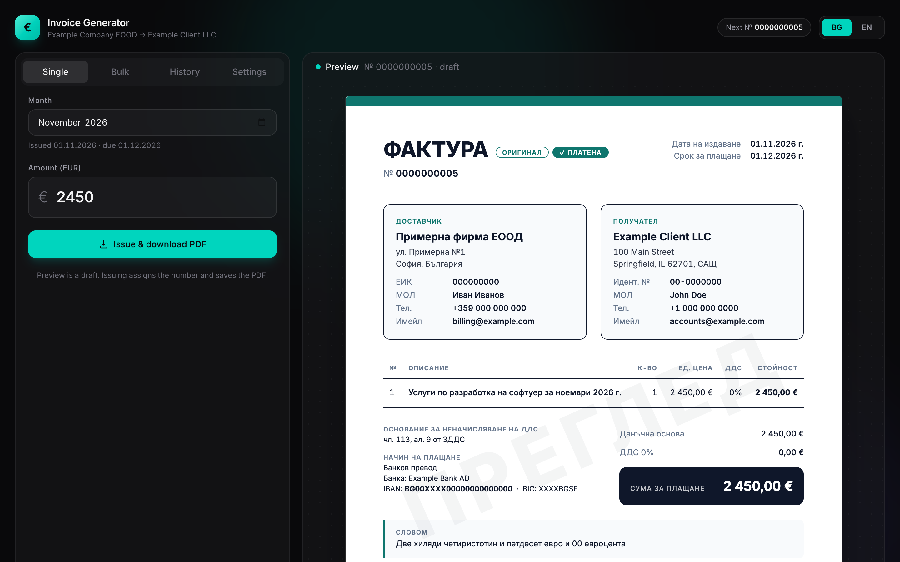
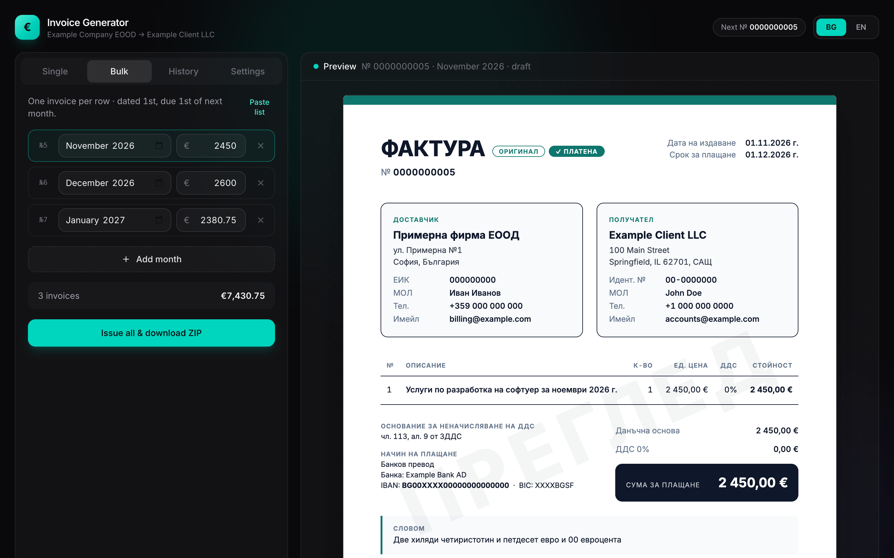
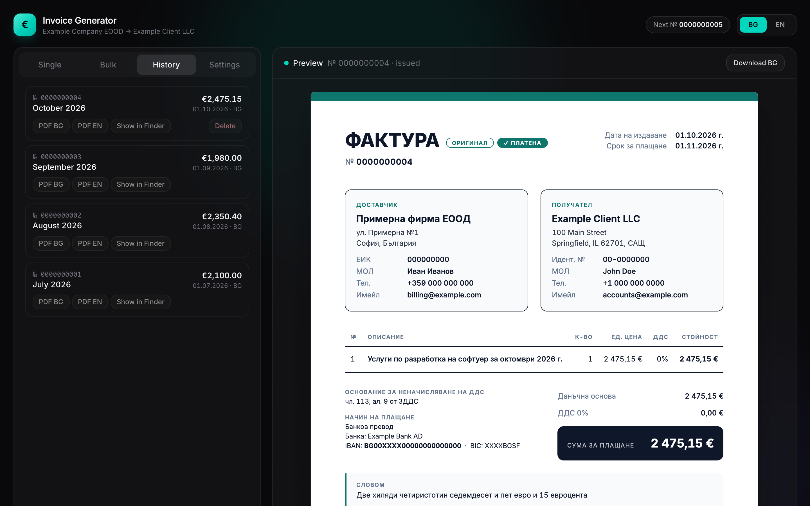
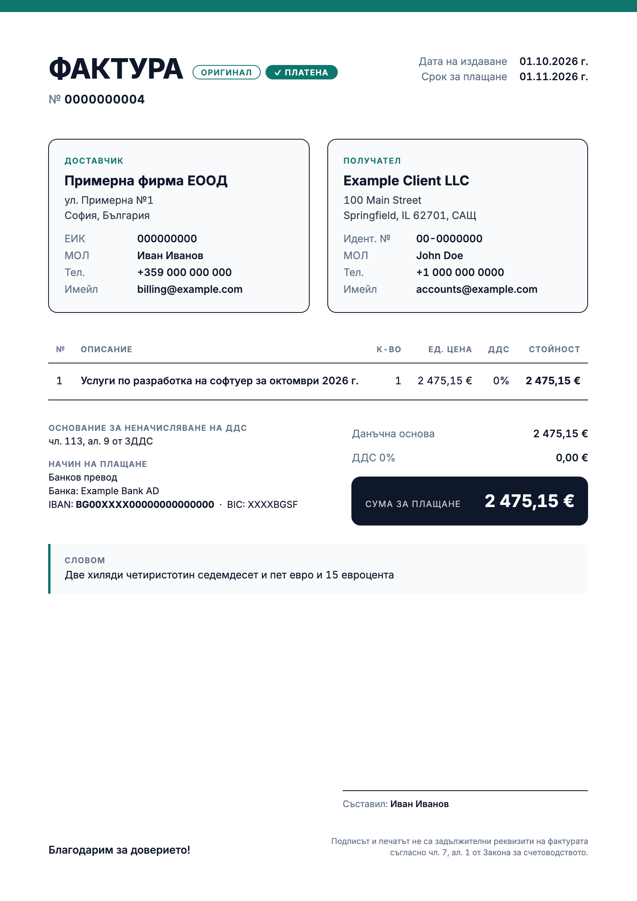
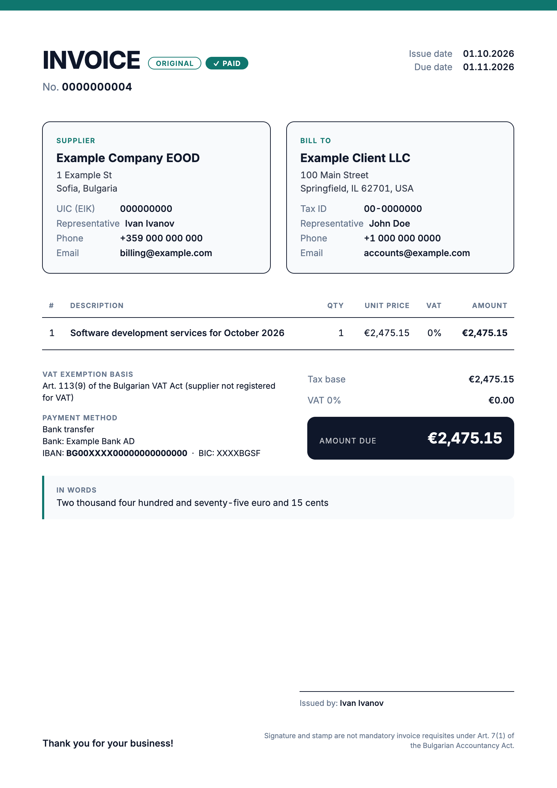
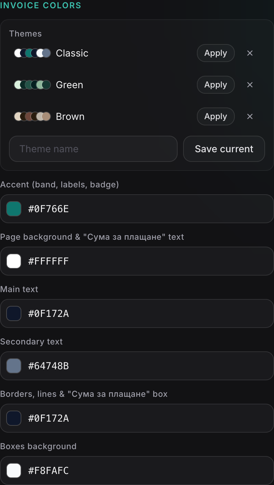

# Генератор на фактури

[English version](README.en.md)

Локален генератор на фактури за български фирми, които фактурират един и същ клиент всеки месец. Работи изцяло на Вашия компютър, сумите са винаги в евро (€), а фактурите се издават на български (по подразбиране) или на английски език и се експортират в PDF.

## Екранни снимки



| Групово издаване | Архив |
|---|---|
|  |  |

| Фактура (BG) | Фактура (EN) | Цветови теми |
|---|---|---|
|  |  |  |

Снимките са с примерни данни. Можете да ги създадете отново с `npm run screenshots` — скриптът използва временни данни и не променя Вашите.

## Възможности

- **Преглед на живо** — фактурата се обновява, докато въвеждате месеца и сумата.
- **Групово издаване** — добавете по един ред за месец (месец + сума) или поставете списък; всички фактури се изтеглят като ZIP архив.
- **Архив** — изтеглете отново всяка издадена фактура на български или английски език.
- **Настройки** — данни на доставчика и клиента, банкова сметка (IBAN), основание за неначисляване на ДДС, начален номер, папка за запис.
- **Цветови теми** — 6 цвята в HEX формат с визуализация; запазвайте и прилагайте собствени теми. Включени са готовите теми „Classic“, „Green“ и „Brown“.
- **CLI** — всичко, което прави уеб интерфейсът, е достъпно и от командния ред.
- Тъмен, бърз интерфейс с Tailwind CSS. Без база данни и без външни услуги.

## Онлайн версия

**[https://omegaskiller.github.io/invoice-generator/](https://omegaskiller.github.io/invoice-generator/)** — работи директно в браузъра, без инсталация и без регистрация.

- Данните (настройки, теми, издадени фактури) се пазят само във Вашия браузър (localStorage). Нищо не се изпраща към сървър.
- PDF се създава чрез прозореца за печат на браузъра: изберете „Save as PDF“ (Запази като PDF). При групово издаване всички фактури се отпечатват като един PDF файл с по една страница на фактура.
- Изтриването на данните на сайта изтрива и архива с фактури. Експортирайте редовно резервно копие от **Settings → Backup**.

Локалната версия (по-долу) записва истински PDF файлове в папка, създава ZIP архиви и има команден ред (CLI).

## Изисквания

- Node.js 20 или по-нова версия
- Google Chrome, Chromium, Edge или Brave (използва се за създаване на PDF). Ако браузърът е на нестандартно място, задайте пътя в `CHROME_PATH`.

## Стартиране

```bash
npm install
npm start
```

Отворете http://localhost:4321 и попълнете Вашите данни в раздел **Settings**. Те се записват в `data/settings.json`, който не се качва в Git.

## Дати и номерация

- **Дата на издаване:** 1-во число на месеца.
- **Срок за плащане:** 1-во число на следващия месец.
- **Номер:** 10 цифри, поредна номерация (`0000000001`, `0000000002`, …). Продължава от последната издадена фактура или от началния номер в настройките.
- Всяка фактура носи отметка „Платена“.

## Команден ред (CLI)

```bash
node cli.js new -m 2026-11 -a 1250.50              # една фактура (с потвърждение)
node cli.js new -m 2026-11 -a 1250.50 -l en --yes   # на английски, без потвърждение
node cli.js bulk 2026-01=1000 2026-02=1100 --preview  # само преглед (HTML), без издаване
node cli.js bulk -f templates/example.txt --yes     # групово издаване от файл
node cli.js list                                    # списък с издадени фактури
node cli.js pdf 5 -l en                             # нов PDF на издадена фактура
node cli.js next                                    # следващ номер
```

С `npm link` командата става достъпна глобално като `invoice`.

Шаблоните за групово издаване са текстови файлове с по един ред `YYYY-MM сума`. Редовете, които започват с `#`, са коментари. Вижте [templates/example.txt](templates/example.txt).

## Файлове

| Път | Съдържание |
|---|---|
| `data/settings.json` | Вашите настройки (създава се при първото стартиране) |
| `data/invoices.json` | Издадените фактури. Всяка пази копие на данните си, затова старите фактури не се променят. |
| `data/logo.png` / `.svg` | Лого на фактурата (по избор) |
| `output/` | Създадените PDF файлове (папката може да се промени в настройките) |
| `templates/` | Шаблони за групово издаване |

Всички лични данни остават в `data/`, `output/` и `templates/`, които са изключени от Git.

## Съответствие със законодателството

Фактурата съдържа реквизитите по чл. 114 от ЗДДС: наименование „Фактура“ и „Оригинал“, 10-цифрен пореден номер, дата на издаване, наименование, адрес и ЕИК на доставчика и получателя, МОЛ, описание, количество, единична цена, данъчна основа, ставка и размер на ДДС, обща сума и сума словом.

По подразбиране основанието за неначисляване на ДДС е чл. 113, ал. 9 от ЗДДС (доставчикът не е регистриран по ДДС). Ако фирмата Ви е регистрирана, въведете ДДС номера и сменете основанието в настройките.

Подписът и печатът не са задължителни реквизити съгласно чл. 7, ал. 1 от Закона за счетоводството.

> Инструментът не е правна консултация. Проверете фактурите с Вашия счетоводител.

## Разработка

```bash
npm run build:static   # създава уеб версията в dist/
npm run screenshots    # обновява екранните снимки с примерни данни
```

При всяко качване в клон `main` GitHub Actions публикува `dist/` в GitHub Pages.

## Лиценз

MIT
